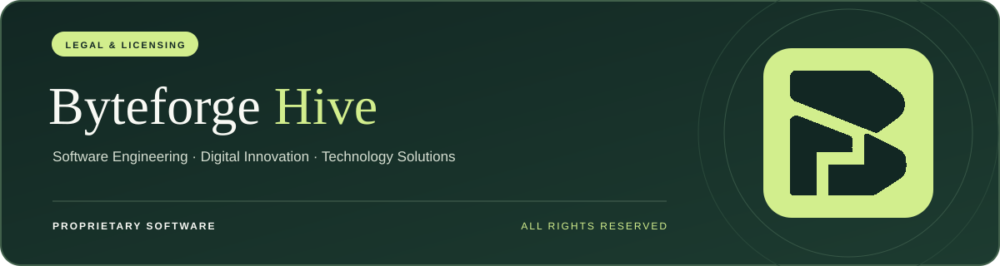

# Proprietary Software License

**Copyright © 2026 BYTEFORGE HIVE. All rights reserved.**

| License information | Details |
| --- | --- |
| Classification | Proprietary — All Rights Reserved |
| Version | 1.1 |
| Effective date | November 17, 2026 |
| Licensing contact | info@byteforgehive.com |
| Website | https://byteforgehive.com/ |

[Ownership](#1-scope-and-ownership) · [Commercial licensing](#4-authorized-use-and-commercial-licensing) · [Third-party rights](#5-third-party-materials) · [Contact](#10-permissions-and-enquiries)

---

This document reserves rights in BYTEFORGE HIVE's proprietary materials. It does
not grant an open-source license or replace a separate written agreement.

## 1. Scope and ownership

This notice applies to the original software and associated materials owned by
BYTEFORGE HIVE, or for which BYTEFORGE HIVE has the right to impose these terms,
including protected source and object code, implementations, architecture,
application programming interfaces, designs, documentation and other proprietary
materials supplied with this notice (collectively, the “Software”).

All applicable intellectual property rights remain with BYTEFORGE HIVE or their
respective lawful owners. No ownership is transferred. This notice does not
claim ownership of third-party materials or of ideas, methods or other subject
matter that applicable law does not protect.

## 2. Reservation of rights; no implied license

The Software is proprietary and is not offered under an open-source license.
Except as expressly permitted by a separate written agreement, applicable law,
or the preserved rights described in this notice, no permission is granted to
use, reproduce, modify, distribute, sublicense or commercially exploit the
Software.

Access to a repository, possession of a copy, or public availability does not
by itself grant additional rights. No copyright, patent, trademark or other
intellectual property license is granted by implication.

Where materials are hosted on GitHub or another platform, permissions arising
under the applicable platform terms remain unaffected. For example, this notice
does not override viewing or forking permissions provided through GitHub's
public-repository functionality. Those permissions do not create a broader
license under this notice.

## 3. Restricted activities

Unless authorized under Section 2, no person or organization may:

- Use, copy, reproduce or redistribute the Software or protected portions of it.
- Modify, adapt, translate or create derivative works from the Software.
- Sell, sublicense, rent, lease or otherwise distribute or make the Software
  available to others.
- Host or deploy the Software as a commercial service, including a
  Software-as-a-Service offering, hosted API or managed platform.
- Incorporate protected portions of the Software into another product or
  service, whether competing or otherwise.
- Remove, obscure, alter or misrepresent copyright notices, license notices,
  attribution requirements or ownership information.

These restrictions apply only to the extent permitted by applicable law.
They do not override lawful exceptions, existing grants or third-party rights.

## 4. Authorized use and commercial licensing

BYTEFORGE HIVE may grant permissions through a separate written agreement,
including commercial or enterprise licenses, SaaS subscriptions, API and SDK
licenses, and development, integration or partnership agreements.

An authorization must be issued by BYTEFORGE HIVE or its authorized
representative and identify the permissions granted. Permission for one purpose
does not imply permission for another.

The applicable written agreement governs the authorized use and takes
precedence over this notice to the extent of a conflict. This notice does not
expand, cancel or replace rights or obligations under that agreement.

## 5. Third-party materials

The Software may include or depend on third-party code, libraries, frameworks,
models, datasets, fonts, media or other materials governed by separate terms.
Those materials remain subject to their own licenses and notices.

Nothing in this notice changes their ownership, reduces rights granted under
their licenses, or excuses compliance with their conditions, including
attribution, notice, source-disclosure or redistribution obligations where
applicable. If this notice conflicts with the applicable third-party terms,
those terms govern the affected third-party materials.

## 6. Earlier licenses and existing grants

Permissions validly granted for an earlier version or copy under an open-source,
commercial or other license remain governed by that license and its conditions.
Publishing this notice does not retroactively revoke or narrow those grants.

This notice applies only to materials and rights that BYTEFORGE HIVE is entitled
to license on these terms. It does not relicense another contributor's work or
third-party material without the necessary authority. Existing copyright notices
and applicable license notices must be preserved as required.

## 7. Trademarks and branding

The BYTEFORGE HIVE name, product names, logos, brand identities and associated
trademarks or service marks belong to their respective lawful owners.

No permission to use those marks or imply sponsorship, affiliation or endorsement
is granted by this notice, except where separately authorized or permitted by law.

## 8. Disclaimer of warranties

Except as expressly provided in a separate written agreement, and to the maximum
extent permitted by applicable law, the Software is provided **“AS IS” and
“AS AVAILABLE,” without warranties of any kind**, whether express, implied or
statutory, including warranties of merchantability, fitness for a particular
purpose, title and non-infringement.

BYTEFORGE HIVE does not promise that the Software will be uninterrupted,
error-free, secure against every threat, or suitable for a particular purpose.
Mandatory warranties and rights that cannot lawfully be excluded remain intact.

## 9. Limitation of liability

Except as expressly provided in a separate written agreement, and to the maximum
extent permitted by applicable law, BYTEFORGE HIVE and its licensors shall not
be liable for indirect, incidental, special, consequential or punitive damages,
or for loss of profits, revenue, data or business opportunities, arising out of
access to or use of the Software, even if advised of the possibility of such
loss or damage.

Nothing in this notice excludes or limits liability, remedies or consumer rights
that cannot lawfully be excluded or limited.

## 10. Permissions and enquiries

For permission to use, distribute, integrate or commercially license the Software,
contact BYTEFORGE HIVE:

- **Email:** [info@byteforgehive.com](mailto:info@byteforgehive.com)
- **Website:** [byteforgehive.com](https://byteforgehive.com/)

Submitting an enquiry, receiving repository access or discussing a proposed
arrangement does not itself grant a license. Any permission must be documented
as described in Section 4.

---

**BYTEFORGE HIVE**  
Software Engineering · Digital Innovation · Technology Solutions

**Proprietary software. All rights reserved, subject to the applicable agreements,
licenses and legal rights expressly preserved above.**
