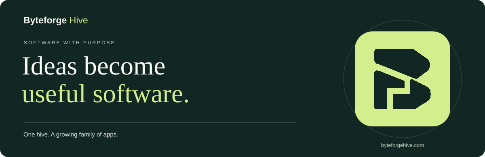

  

  <strong>Thoughtful apps for work and life.</strong> 
  One hive. A growing family of apps. Care in every detail.

  <a href="https://byteforgehive.com/"><strong>Explore Byteforge Hive ↗</strong></a>
  &nbsp; · &nbsp;
  <a href="https://beta.evalistra.byteforgehive.com/">Try Evalistra</a>
  &nbsp; · &nbsp;
  <a href="mailto:info@byteforgehive.com">Get in touch</a>

---

### Built at the Hive

We turn ideas into useful software. Each app has a purpose of its own, with the same attention to the people using it and the details that make everyday work feel easier.

#### Evalistra · Available in beta

**A clearer picture of potential.** Bring assessments, interviews and results together, giving candidates room to show what they can do and teams a better way to review the whole picture.

[Explore Evalistra →](https://beta.evalistra.byteforgehive.com/)

#### Taking shape · Coming soon

| | | |
| :--- | :--- | :--- |
| **Nearby** | **Realtor Nova** | **Estovio** |
| **Pawscribe** | **Pawform** | **Syllivo** |

Follow the next chapters on [byteforgehive.com](https://byteforgehive.com/).

---

  <strong>Good things start with a conversation.</strong> 
  Ideas, questions, or a hello — <a href="mailto:info@byteforgehive.com">info@byteforgehive.com</a>

Byteforge Hive · Software with purpose.

